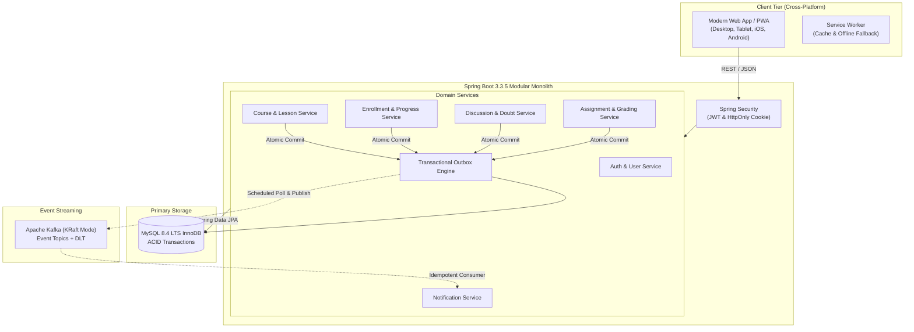

# LearnLoop 🎓
> **Production-Ready, Cross-Platform Learning Management & Academic Doubt-Solving Platform**

[](https://adoptium.net/)
[](https://spring.io/projects/spring-boot)
[](https://www.mysql.com/)
[](https://kafka.apache.org/)
[](https://flywaydb.org/)
[](#cross-platform-pwa)
[](#)

---

## 1. Executive Summary & Value Proposition

**LearnLoop** is an enterprise-grade, full-stack educational SaaS platform designed to seamlessly connect **Students**, **Teachers**, and **Institutions** into an integrated learning ecosystem.

Unlike traditional toy projects, LearnLoop implements real-world distributed systems patterns, including:
- **Transactional Outbox Pattern** with **Apache Kafka (KRaft mode)** for atomic event streaming and eventual consistency.
- **Consumer Idempotency Store** preventing duplicate side-effects from network retries.
- **Strict Multi-Tenant Content Redaction** preventing syllabus tampering and unauthorized material access.
- **Modular Monolith** architecture with clean domain boundaries, eliminating unnecessary microservice overhead while enabling straightforward team scalability.
- **Modern Progressive Web App (PWA)** built with semantic HTML5, glassmorphic CSS3, and ES Modules without heavy frontend dependencies.

---

## 2. Technology Stack

### Backend & Event Streaming
- **Language & Runtime**: Java 21 LTS (tested and verified on Java 25)
- **Framework**: Spring Boot 3.3.5
- **Security**: Spring Security (Stateless JWT + HttpOnly SameSite=Lax cookie authentication)
- **Persistence**: Spring Data JPA, Hibernate, HikariCP
- **Database**: **MySQL 8.4 LTS** with versioned **Flyway** schema migrations
- **Messaging & Streaming**: Spring Kafka + Apache Kafka 7.6.1 in **KRaft mode** (Zero ZooKeeper dependencies)
- **Documentation**: OpenAPI 3.0 & Swagger UI via `springdoc-openapi`
- **Observability**: Spring Boot Actuator (`/actuator/health`, `/actuator/info`)
- **Testing**: JUnit 5, Mockito, AssertJ, Maven Surefire

### Frontend & Progressive Web App (PWA)
- **Structure**: Semantic HTML5 with accessibility attributes (ARIA)
- **Styling**: Vanilla CSS3 design system with CSS custom properties, glassmorphism, responsive flex/grid layouts, Google Fonts (Outfit & Inter)
- **Logic**: Vanilla JavaScript using modern ES Modules (`type="module"`)
- **HTTP Client**: Native Fetch API with unified request correlation headers (`X-Correlation-ID`)
- **Offline & Install**: W3C Web App Manifest (`manifest.json`) + Service Worker (`sw.js`) with cache-first static asset delivery and offline fallback page

### Infrastructure & DevOps
- **Containerization**: Multi-stage production `Dockerfile` (Maven builder -> Eclipse Temurin 21 JRE runtime, non-root user)
- **Orchestration**: `docker-compose.yml` with healthchecks for MySQL 8.4, Kafka KRaft, and LearnLoop App
- **Continuous Integration**: GitHub Actions workflow (`.github/workflows/ci.yml`)

---

## 3. High-Level Architecture



---

## 4. Key Workflows & Engineering Features

### 🎓 1. Student Enrollment & Outbox Kafka Notification
1. Student clicks **Enroll** on a published course.
2. In a single MySQL database transaction, `EnrollmentService` records the active enrollment and writes an `OutboxEvent` with status `PENDING`.
3. The HTTP response completes in `< 30ms`.
4. The background `OutboxPublisher` polls the outbox, dispatches the event to `learnloop.enrollment.events`, and marks the outbox record `PUBLISHED`.
5. `NotificationEventConsumer` processes the message, checks the `processed_events` table for deduplication, and writes a persistent in-app notification for the student.

### ❓ 2. Academic Doubt-Solving & Instructor Verification
1. Enrolled students ask academic questions tied to a course and specific lesson.
2. Questions feature live status tracking (`OPEN`, `ANSWERED`, `RESOLVED`).
3. Teachers review unanswered questions in their teacher dashboard and reply.
4. Replies automatically flag the author with a verified **Instructor Badge**, update the question state to `ANSWERED`, and dispatch an outbox notification event to the student.

### 📝 3. Coursework Submission & Precise Grading
1. Teachers publish assignments with strict due dates and maximum marks (stored as exact `DECIMAL(5,2)`).
2. Students submit coursework responses and reference links.
3. Teachers review submissions in an interactive modal, award scores, and provide constructive feedback.
4. An outbox event alerts the student that their grade and feedback have been published.

### 🛡️ 4. Content Redaction & Security
- Lessons belonging to paid or private courses have their `contentUrlOrText` redacted to `[ENROLLMENT_REQUIRED]` when viewed by unauthenticated users or unenrolled students.
- Self-registration as `ADMIN` is strictly forbidden at the API layer.
- All mutating endpoints enforce user ownership server-side.

---

## 5. Local Development Quickstart

### Prerequisites
- **Java**: JDK 21 LTS or higher (`java -version`)
- **Docker & Docker Compose**: For local MySQL and Kafka infrastructure (`docker compose version`)
- **Maven**: Included via Maven Wrapper (`./mvnw`)

### Step 1: Clone and Configure Environment
```bash
git clone https://github.com/your-username/learn_loop.git
cd learn_loop

# Copy environment template
cp .env.example .env
```

### Step 2: Start MySQL 8.4 and Kafka KRaft
```bash
docker compose up -d mysql kafka
```
*Wait ~20 seconds for the health checks to become healthy (`docker compose ps`).*

### Step 3: Run Database Migrations & Start Backend
#### On macOS / Linux:
```bash
./mvnw clean spring-boot:run
```

#### On Windows PowerShell:
```powershell
.\mvnw.cmd clean spring-boot:run
```

Flyway will automatically apply all migrations (`V1` through `V6`) to MySQL 8.4 and create the initial administrator account.

### Step 4: Open in Browser
- **LearnLoop Web Application**: [http://localhost:8080](http://localhost:8080)
- **Interactive Swagger UI**: [http://localhost:8080/swagger-ui.html](http://localhost:8080/swagger-ui.html)
- **Spring Actuator Health**: [http://localhost:8080/actuator/health](http://localhost:8080/actuator/health)

---

## 6. Default Demonstration Accounts

| Role | Email | Password | Preloaded Capabilities |
| :--- | :--- | :--- | :--- |
| **Admin** | `admin@learnloop.com` | `Admin@LearnLoop2026!` | Full administrative dashboard, user suspension, role management, outbox backlog monitoring |
| **Teacher** | *(Self-register or use demo)* | `Password123!` | Create/publish courses, add lessons, grade assignments, answer doubts |
| **Student** | *(Self-register or use demo)* | `Password123!` | Browse catalog, enroll in courses, mark lessons complete, submit coursework |

---

## 7. Automated Testing & Verification

LearnLoop includes automated unit and integration tests covering security, domain services, and Kafka consumer idempotency:

```bash
# Execute test suite
./mvnw clean test
```

### Test Suite Results:
```text
[INFO] Running com.learnloop.domain.user.AuthServiceTest
[INFO] Tests run: 4, Failures: 0, Errors: 0, Skipped: 0
[INFO] Running com.learnloop.domain.course.CourseServiceTest
[INFO] Tests run: 4, Failures: 0, Errors: 0, Skipped: 0
[INFO] Running com.learnloop.domain.enrollment.EnrollmentServiceTest
[INFO] Tests run: 3, Failures: 0, Errors: 0, Skipped: 0
[INFO] Running com.learnloop.domain.discussion.DiscussionServiceTest
[INFO] Tests run: 3, Failures: 0, Errors: 0, Skipped: 0
[INFO] Running com.learnloop.domain.assignment.AssignmentServiceTest
[INFO] Tests run: 4, Failures: 0, Errors: 0, Skipped: 0
[INFO] Running com.learnloop.domain.outbox.IdempotencyServiceTest
[INFO] Tests run: 2, Failures: 0, Errors: 0, Skipped: 0
[INFO] Running com.learnloop.domain.kafka.NotificationEventConsumerTest
[INFO] Tests run: 3, Failures: 0, Errors: 0, Skipped: 0
[INFO] -------------------------------------------------------
[INFO] BUILD SUCCESS
[INFO] Total tests run: 23, Failures: 0, Errors: 0, Skipped: 0
```

---

## 8. Documentation Index

Detailed architectural and operational documentation is available in the [`docs/`](file:///Users/shalabksr23/ALL%20PROJECT%20FOLDER/learn_loop/docs) directory:

- [ARCHITECTURE.md](file:///Users/shalabksr23/ALL%20PROJECT%20FOLDER/learn_loop/docs/ARCHITECTURE.md) — Modular monolith rationale, component responsibilities, and transaction boundaries.
- [ER_DIAGRAM.md](file:///Users/shalabksr23/ALL%20PROJECT%20FOLDER/learn_loop/docs/ER_DIAGRAM.md) — Complete MySQL 8.4 schema, data types, indexes, and Mermaid entity-relationship diagram.
- [API.md](file:///Users/shalabksr23/ALL%20PROJECT%20FOLDER/learn_loop/docs/API.md) — Full REST endpoint catalog under `/api/v1` with request/response payloads.
- [SECURITY.md](file:///Users/shalabksr23/ALL%20PROJECT%20FOLDER/learn_loop/docs/SECURITY.md) — Authentication flow, BCrypt hashing, RBAC, XSS/CORS, and secrets management.
- [KAFKA.md](file:///Users/shalabksr23/ALL%20PROJECT%20FOLDER/learn_loop/docs/KAFKA.md) — Event contracts, Transactional Outbox sequence diagrams, and consumer idempotency.
- [DEPLOYMENT.md](file:///Users/shalabksr23/ALL%20PROJECT%20FOLDER/learn_loop/docs/DEPLOYMENT.md) — Step-by-step production cloud deployment with managed MySQL & Kafka.
- [TESTING.md](file:///Users/shalabksr23/ALL%20PROJECT%20FOLDER/learn_loop/docs/TESTING.md) — Test matrix, assertions, and JVM execution instructions.

---

## 9. License

This project is licensed under the MIT License - see the LICENSE file for details.
