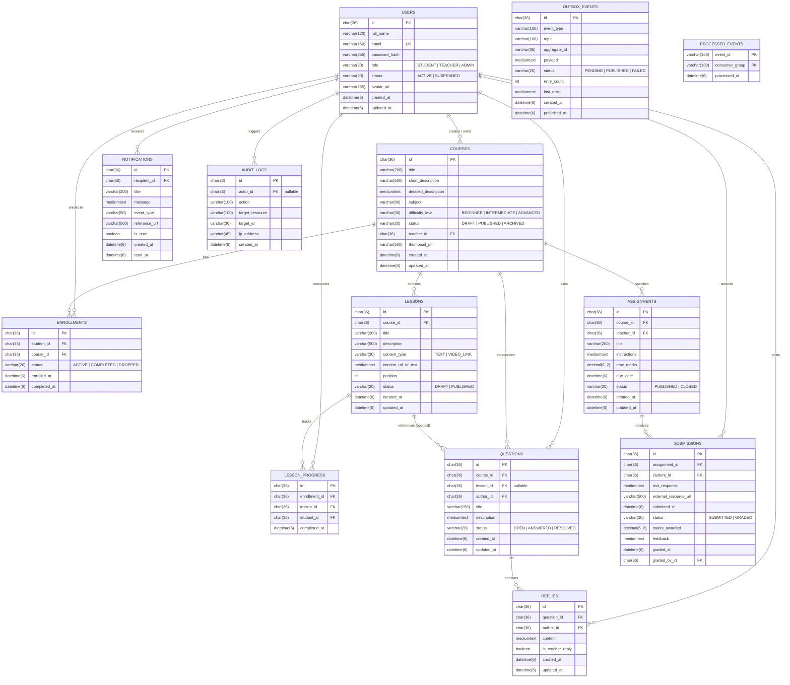

# LearnLoop Database Schema & Entity-Relationship Model (MySQL 8.4 LTS)

## 1. Storage Engine & Dialect Specifications

LearnLoop uses **MySQL 8.4 LTS** with the following database engine specifications:
- **Engine**: `InnoDB` with ACID transaction compliance.
- **Character Set**: `utf8mb4` with collation `utf8mb4_unicode_ci` (full multilingual & emoji support).
- **Timezone**: All timestamps are stored as `DATETIME(6)` in Coordinated Universal Time (UTC).
- **Primary Identifiers**: Standardized UUIDv4 strings stored as `CHAR(36)`.
- **Numeric Precision**: Grading marks use `DECIMAL(5,2)` for exact fractional scores without IEEE 754 floating-point inaccuracies.

---

## 2. Mermaid Entity-Relationship Diagram

---

## 3. Relational Constraints & Indexing Strategy

| Table | Constraint / Index Name | Columns | Purpose |
| :--- | :--- | :--- | :--- |
| `users` | `uk_users_email` | `email` (UNIQUE) | Prevents duplicate user accounts |
| `enrollments` | `uk_enrollment_student_course` | `student_id, course_id` (UNIQUE) | Guarantees single active enrollment per student |
| `lesson_progress` | `uk_progress_enrollment_lesson` | `enrollment_id, lesson_id` (UNIQUE) | Guarantees lesson completion idempotency |
| `submissions` | `uk_submission_student_assignment` | `assignment_id, student_id` (UNIQUE) | Enforces single submission per assignment |
| `processed_events` | `PRIMARY KEY` | `event_id, consumer_group` | Prevents duplicate Kafka event side-effects |
| `notifications` | `idx_notif_recipient_read` | `recipient_id, is_read, created_at` | Speeds up unread notification counter & drawer queries |
| `lessons` | `idx_lessons_course_pos` | `course_id, position` | Efficient sequential syllabus loading |
| `questions` | `idx_questions_course_status` | `course_id, status, created_at` | Filtered doubt board retrieval |
| `outbox_events` | `idx_outbox_status_created` | `status, retry_count, created_at` | Fast background polling of pending events |
| `courses` | `idx_courses_status_cat` | `status, subject` | High-performance public course catalog search |
