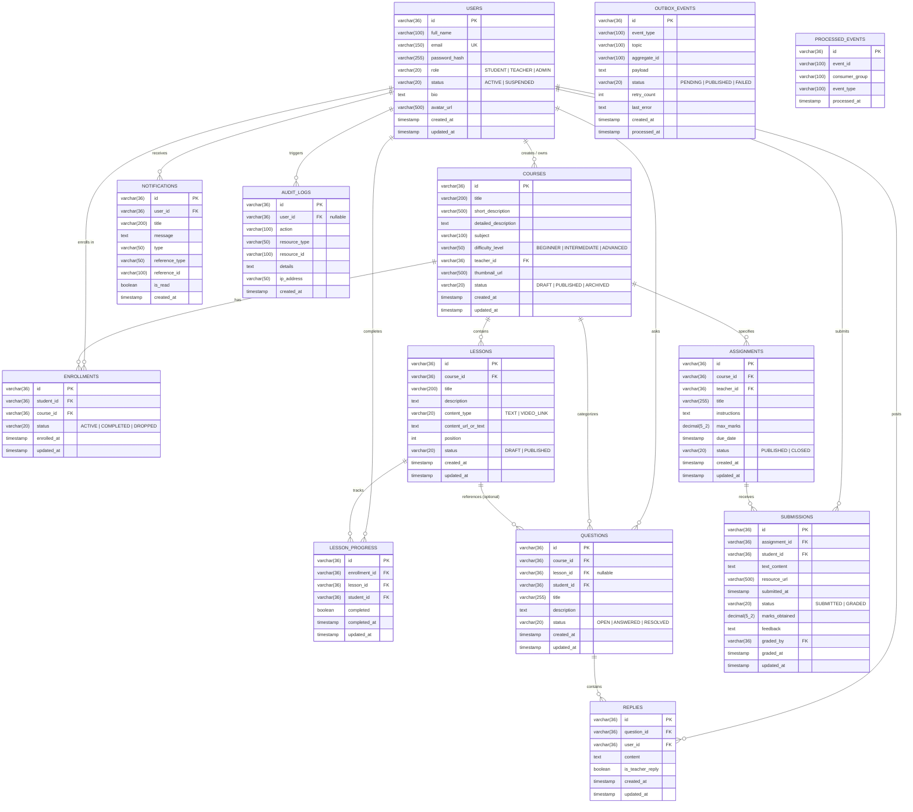

# LearnLoop Database Schema & Entity-Relationship Model (PostgreSQL)

## 1. Storage Engine & Dialect Specifications

LearnLoop uses **PostgreSQL (v16 LTS)** with the following specifications:
- **Engine**: PostgreSQL Relational Engine with full ACID transaction compliance.
- **Character Set**: `UTF8` with collation `en_US.UTF-8` or `C.UTF-8`.
- **Timezone**: All timestamps are stored as `TIMESTAMP` in Coordinated Universal Time (UTC).
- **Primary Identifiers**: Standardized UUIDv4 strings stored as `VARCHAR(36)`.
- **Numeric Precision**: Grading marks use `DECIMAL(5,2)` for exact fractional scores without floating-point inaccuracies.
- **Dialect**: `org.hibernate.dialect.PostgreSQLDialect`.

---

## 2. Mermaid Entity-Relationship Diagram

---

## 3. Relational Constraints & Indexing Strategy

| Table | Constraint / Index Name | Columns | Purpose |
| :--- | :--- | :--- | :--- |
| `users` | `uq_users_email` | `email` (UNIQUE) | Prevents duplicate user accounts |
| `enrollments` | `uq_enrollments_student_course` | `student_id, course_id` (UNIQUE) | Guarantees single active enrollment per student |
| `lesson_progress` | `uq_progress_enrollment_lesson` | `enrollment_id, lesson_id` (UNIQUE) | Guarantees lesson completion idempotency |
| `submissions` | `uq_submissions_assignment_student` | `assignment_id, student_id` (UNIQUE) | Enforces single submission per assignment |
| `processed_events` | `uq_processed_events` | `event_id, consumer_group` (UNIQUE) | Prevents duplicate Kafka event side-effects |
| `notifications` | `idx_notifications_unread` | `user_id, is_read` | Speeds up unread notification counter & drawer queries |
| `lessons` | `idx_lessons_position` | `course_id, position ASC` | Efficient sequential syllabus loading |
| `questions` | `idx_questions_status` | `status` | Filtered doubt board retrieval |
| `outbox_events` | `idx_outbox_status` | `status, created_at ASC` | Fast background polling of pending events |
| `courses` | `idx_courses_status` | `status` | High-performance public course catalog search |
