# LearnLoop Apache Kafka Architecture & Event Streaming

## 1. Topic Architecture

LearnLoop leverages Apache Kafka (KRaft mode) for asynchronous event-driven notifications and decoupled processing.

| Topic Name | Purpose | Partition Key | Consumers |
| :--- | :--- | :--- | :--- |
| `learnloop.enrollment.events` | Course enrollment notifications | `studentId` | `NotificationConsumer` |
| `learnloop.discussion.events` | Doubt replies & discussion threads | `questionId` | `NotificationConsumer` |
| `learnloop.assignment.events` | Assignment submissions & grade releases | `studentId` | `NotificationConsumer` |
| `learnloop.learning-activity.events`| Lesson completions & progress analytics | `studentId` | `LearningActivityConsumer` |
| `learnloop.course.events` | Course publication & syllabus updates | `courseId` | `AuditConsumer` |
| `learnloop.dlt` | Dead-letter queue for unrecoverable errors | `eventId` | Operational Alerting |

---

## 2. Event Contract Standard (`BaseEvent`)

Every event published to Kafka conforms to an immutable, versioned envelope:

```json
{
  "eventId": "a1b2c3d4-e5f6-7a8b-9c0d-1e2f3a4b5c6d",
  "eventType": "ENROLLMENT_CONFIRMATION",
  "schemaVersion": 1,
  "aggregateId": "f7890123-4567-89ab-cdef-0123456789ab",
  "timestamp": 1729460400000,
  "studentId": "01234567-89ab-cdef-0123-456789abcdef",
  "courseId": "f7890123-4567-89ab-cdef-0123456789ab",
  "courseTitle": "Full-Stack Software Architecture with Spring Boot",
  "studentName": "Alex Chen",
  "teacherId": "89abcdef-0123-4567-89ab-cdef01234567"
}
```

---

## 3. Transactional Outbox Pattern & Reliability

To prevent lost events or partial commits between the database and the message broker, LearnLoop uses the **Transactional Outbox Pattern**:

```mermaid
sequenceDiagram
    autonumber
    actor Student
    participant Controller as EnrollmentController
    participant Service as EnrollmentService
    participant DB as MySQL 8.4 (InnoDB)
    participant OutboxPoller as OutboxPublisher (Scheduled)
    participant Kafka as Apache Kafka Broker
    participant Consumer as NotificationEventConsumer

    Student->>Controller: POST /api/v1/courses/{id}/enroll
    Controller->>Service: enroll(studentId, courseId)
    
    rect rgb(20, 30, 45)
        note right of Service: Single ACID Database Transaction
        Service->>DB: INSERT INTO enrollments (...)
        Service->>DB: INSERT INTO outbox_events (status = 'PENDING', payload = ...)
        DB-->>Service: Commit OK
    end
    
    Service-->>Controller: Return 201 Created (HTTP response returned immediately)
    Controller-->>Student: Enrollment Confirmed (No Kafka wait)

    loop Every 3000ms
        OutboxPoller->>DB: SELECT * FROM outbox_events WHERE status = 'PENDING' LIMIT 50
        DB-->>OutboxPoller: List of pending events
        OutboxPoller->>Kafka: send(topic, partitionKey, payload)
        Kafka-->>OutboxPoller: Broker ACK
        OutboxPoller->>DB: UPDATE outbox_events SET status = 'PUBLISHED'
    end

    Kafka->>Consumer: Push Event to learnloop-group
    Consumer->>DB: INSERT INTO processed_events (event_id, consumer_group)
    alt First Time Event
        Consumer->>DB: INSERT INTO notifications (recipient_id, message, ...)
        Consumer-->>Kafka: Offset Commit (Manual / Auto ACK)
    else Duplicate Event (Primary Key Collision)
        Consumer-->>Kafka: Skip processing, commit offset safely
    end
```



---

## 4. Consumer Idempotency

Kafka delivers messages with **at-least-once** semantics. If network interruptions prevent a consumer offset commit from reaching the broker, the same event may be redelivered.

LearnLoop protects against duplicate processing using the `processed_events` table in MySQL:
1. When an event arrives, the consumer queries `processed_events` for `(event_id, consumer_group)`.
2. If the tuple exists, the event is immediately discarded without creating duplicate notifications or metrics.
3. If not found, the notification is created and the tuple is inserted in the same database transaction.
4. Database unique key constraint violations (`DuplicateKeyException`) are caught cleanly and logged without throwing unhandled errors.

---

## 5. Failure Recovery & Broker Outages

- **Broker Outage**: If Kafka becomes unreachable, Spring Boot does not fail HTTP requests. Business transactions commit successfully to MySQL, and outbox records remain in `PENDING` state. Once Kafka recovers, the `OutboxPublisher` processes the accumulated backlog in chronological order.
- **Repeated Failures**: If an event fails to serialize or broker rejects delivery after 5 retries (`retry_count >= 5`), the status transitions to `FAILED` and an alert is recorded.
- **Dead-Letter Topic (DLT)**: Events that cannot be deserialized or processed by consumers are redirected to `learnloop.dlt` for inspection by system administrators.
